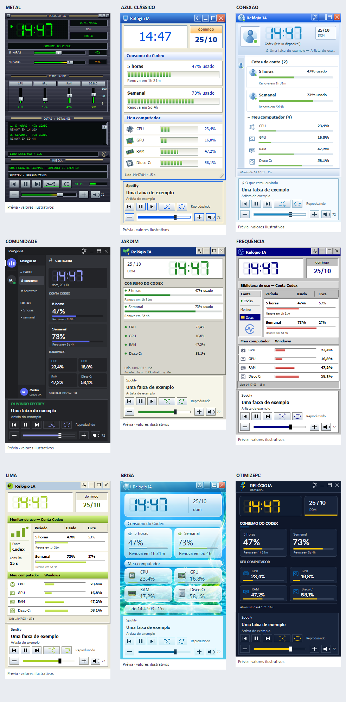

# Relógio IA

Um relógio compacto para Windows com cotas de IA, indicadores do computador e controles locais do Spotify. Um único executável abre o widget; as configurações e o editor ficam no próprio aplicativo.

**Versão v0.1.0-beta.** [Baixar a versão Windows](https://github.com/kombeirodev-ui/relogio-ia/releases/tag/v0.1.0-beta).

## Templates inspirados em clássicos dos anos 2000 e interfaces atuais

Os templates são inspirados na aparência dos players de música, programas de bate-papo e interfaces de computador do início dos anos 2000, além de aplicativos atuais. São interpretações para o Relógio IA, com desenhos próprios.

- **METAL:** inspirado nos players de música clássicos, com metal escuro, mostrador verde e controles em relevo.
- **JARDIM:** inspirado nos programas de bate-papo do início dos anos 2000, com tons claros e indicadores verdes.
- **CONEXÃO:** inspirado nos programas de bate-papo clássicos, com azul, lista de contatos e música como mensagem de status.
- **COMUNIDADE:** inspirado nas interfaces atuais de comunidades e bate-papo, com painel lateral e cartões escuros.
- **FREQUÊNCIA:** inspirado nas bibliotecas de música do início dos anos 2000, com tabelas e acabamento cinza e azul.
- **LIMA:** inspirado nos aplicativos de música e compartilhamento da época, com detalhes em verde-lima.
- **BRISA:** inspirado na estética Frutiger Aero, com água, transparência e painéis de vidro.
- **AZUL CLÁSSICO:** inspirado nas interfaces de computador dos anos 2000, com azul, bege e controles em relevo.
- **OTIMIZEPC:** inspirado na identidade visual da própria marca, utilizada com autorização do proprietário.

## Instalar e usar

1. Baixe o pacote Windows na página da Release.
2. Extraia todo o ZIP em uma pasta e abra `RelogioIA-Publicacao.exe`.
3. Use o botão de configurações para escolher tema, largura e módulos. O botão direito também abre opções.
4. Arraste pelo cabeçalho para posicionar. A largura pode variar entre 240 e 500 pixels; módulos podem ser ocultados.

Para consultar cotas do Codex, tenha o Codex instalado e autenticado. O leitor procura o executável na instalação local conhecida ou no PATH. F5 solicita atualização. Se a conta não fornecer limites, o relógio informa a indisponibilidade; a porcentagem não representa gasto em reais ou dólares.

## Recursos desta beta

- Cotas Codex de cinco horas e semanal, conforme disponibilidade da conta, com horário da leitura e renovação.
- CPU, GPU, RAM e espaço ocupado na unidade do Windows, selecionáveis. Sensores atualizam aproximadamente a cada três segundos.
- Nove temas: METAL, OTIMIZEPC, JARDIM, CONEXÃO, COMUNIDADE, FREQUÊNCIA, LIMA, BRISA e AZUL CLÁSSICO.
- Spotify desktop: faixa, artista, anterior, play/pause, próxima, shuffle, repetir, volume e mudo, conforme os controles disponíveis na sessão local do Windows.
- Relógio e player opcionais, foto com recorte e fade, números de sete segmentos e atlas PNG personalizado.
- Janela compacta ou expandida, sobreposição opcional, posição salva, reinício e opção de iniciar com Windows.
- Alertas por cota restante, desativados por padrão, com importação de WAV.
- Leitor experimental de cotas do Claude Code, ainda sem validação com conta real.

## Requisitos

Windows 10 versão 1809 ou posterior ou Windows 11, com .NET Framework 4.8. Integrações dependem dos respectivos aplicativos e contas. Não precisa manter Node.js, navegador ou servidor web aberto. As fontes incorporadas acompanham o aplicativo e não são instaladas no Windows.

## Dados e privacidade

Preferências, fotos, números e sons importados ficam localmente em `%LOCALAPPDATA%\RelogioIA-Publicacao\settings.json`; o cache de fontes fica na mesma pasta. Exporte preferências com cuidado: elas podem conter suas imagens, sons e posição da janela.

O leitor Codex inicia um processo local para consultar conta e limites, sem pedir inferência. O leitor Claude, quando selecionado, lê o login local do Claude Code e usa o token em uma chamada HTTPS ao serviço Anthropic; não copia nem altera o arquivo de login. Spotify usa a sessão de mídia do Windows e o volume do processo, sem formulário de senha ou chave Spotify. O pacote não contém credenciais.

## Limitações conhecidas

Playlist não é fornecida pela integração local atual. Shuffle, repetir e metadados dependem do que o Spotify expõe. GPU indica o motor mais ocupado; disco indica ocupação, não taxa de leitura ou gravação. A disponibilidade de cotas pode mudar conforme a conta e o serviço.

Na build pessoal em uso, o mantenedor confirmou a abertura automática com o Windows e a sobreposição no jogo testado, incluindo movimentação da janela, cliques, play/pause e retorno ao jogo sem problema de foco. O modo foi descrito como janela cheia; tela cheia exclusiva não foi validada. Esses testes não foram repetidos na edição separada de publicação. Outros jogos, modos de tela, cenários completos de múltiplos monitores e Claude com conta real continuam sem validação. O ZIP final foi extraído e executado neste PC: abriu, respondeu e fechou normalmente. Cotas, sensores e comandos reais do Spotify foram conferidos. Fundos animados ficam para uma versão futura.

## Compilar e contribuir

Veja [CONTRIBUTING.md](CONTRIBUTING.md). O projeto usa C# e WinForms; a compilação nativa é feita por `desktop/build.ps1`. O protótipo web e os materiais históricos não fazem parte deste pacote público.

## Créditos e licença

Projeto independente de [kombeirodev-ui](https://github.com/kombeirodev-ui). A base estudada é [ai-usagebar, de AkitaOnRails](https://github.com/akitaonrails/ai-usagebar), snapshot `d1af986fe4bf8d05316bc8d6e1506881b5f4d265`. O aviso MIT original está preservado em [THIRD_PARTY_NOTICES.md](THIRD_PARTY_NOTICES.md).

Os símbolos e controles desta edição foram desenhados para o relógio, com referências a interfaces históricas. OTIMIZEPC usa identidade autorizada pelo proprietário; fontes incorporadas têm licenças próprias. Não há vínculo ou endosso declarado dos aplicativos de referência.

O código próprio é distribuído sob a licença [MIT](LICENSE). Marcas e materiais de terceiros seguem os avisos e licenças específicos; a licença do código não transfere direitos sobre marcas.

## Sobreposição em jogos

Para interagir com o relógio durante o jogo, prefira janela sem bordas. Em tela cheia exclusiva, clicar em outra janela pode retirar o foco e minimizar ou interromper o jogo; o comportamento depende do jogo e esse modo não foi validado.

## Roadmap

Versões Linux e macOS estão planejadas, sem implementação nesta beta. Veja as etapas e a documentação original consultada em [ROADMAP.md](ROADMAP.md). A versão macOS dependerá de validação em Mac real antes de declarar suporte.
