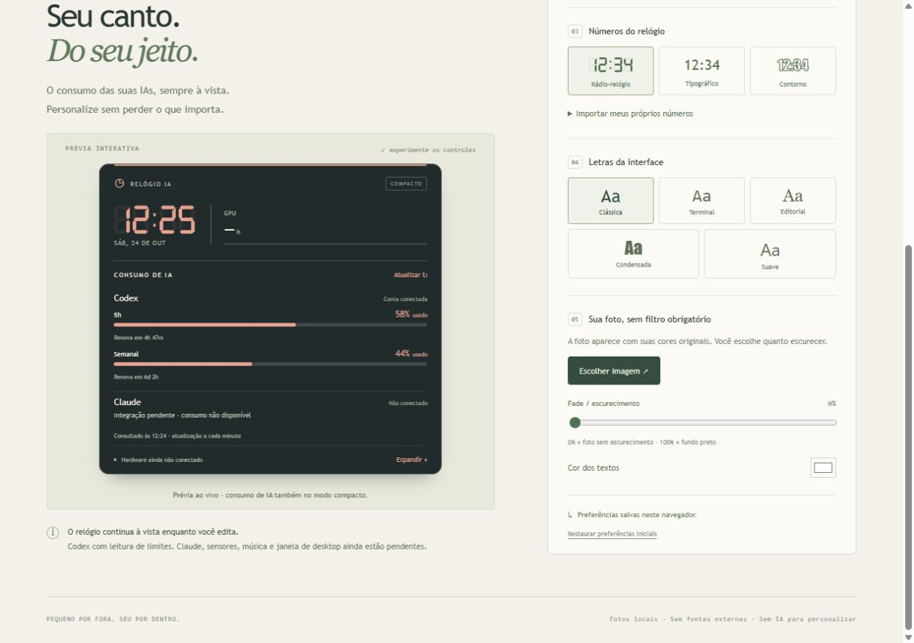

# Relógio IA — correções da primeira interface

Atualizado em 24/10/2026.

## Correções entregues

- Consumo do Codex aparece no modo compacto e expandido, com leituras reais das janelas disponíveis e contagem até renovação.
- Claude aparece explicitamente como não conectado. Não há leitura simulada.
- O fade fixo foi removido. O usuário controla o escurecimento entre 0 e 100%; 0 deixa a foto sem escurecimento. A cor dos textos é ajustável.
- A prévia fica visível durante os ajustes, inclusive em janela estreita.
- Mostrador digital de sete segmentos, como rádio-relógios antigos, além de estilos tipográfico e contorno.
- Importação de faixa PNG com os símbolos `0123456789:` em onze células iguais. Não requer reconhecimento por IA.
- Cinco opções de família de letras da interface; fontes externas não são baixadas.
- Preferências e imagens ficam salvas neste navegador.

## Como experimentar

[Abrir a prévia local](http://127.0.0.1:4387/). O endereço funciona enquanto o servidor deste PC estiver ativo.

Para números próprios: PNG de até 1 MB, fundo transparente recomendado. Exemplo de faixa: 1100 × 150 px, cada célula com 100 × 150 px, na ordem `0123456789:`. O desenho deve ficar dentro da célula correspondente; o aplicativo preserva suas cores e proporções.

## Verificação realizada

- 13 testes de regras e normalização passaram.
- Compilação de produção concluída.
- No navegador: limites reais do Codex visíveis; faixa PNG importada com os cinco símbolos da hora; fade 65% e 0% conferidos no estilo renderizado; fundo e números persistiram após recarregar.
- Prévia permaneceu visível junto do controle de fade em janela de 600 × 800, sem rolagem horizontal.
- Nenhum erro de navegador observado na conferência.
- Arquivos de teste foram removidos das preferências ao terminar; mantidas as escolhas anteriores de cor e hardware.

## Limites atuais

A interface ainda roda no navegador. A consulta de limites é feita pelo servidor local da prévia, usando o Codex instalado, sem iniciar uma conversa de IA. Claude, CPU/GPU reais, Spotify, fundos animados e executável/janela de desktop continuam pendentes. O uso de RAM/CPU do produto final ainda não foi medido.
