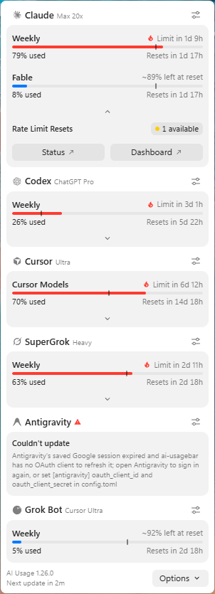
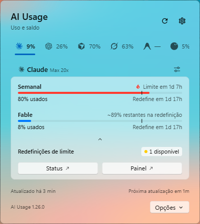
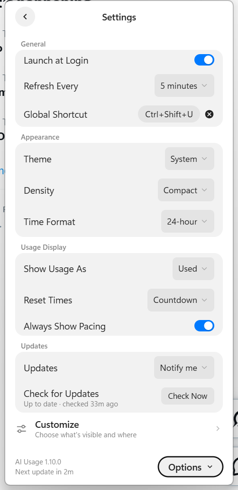

# Estudo inicial — relógio de consumo de IA

Data: 23/10/2026. Inspeção de documentação e código, sem executar o aplicativo.

## Base encontrada e baixada

- Projeto: https://github.com/akitaonrails/ai-usagebar
- Versão declarada: 1.43.0. Commit inspecionado: d1af986.
- Cópia local: `work/ai-usagebar`, dentro desta sessão.
- Licença MIT: permite adaptar e distribuir, preservando o aviso de licença e autoria.
- Código original sem alterações. Não foram instaladas dependências, compilados binários ou acessadas credenciais de IA.

## O que já existe

O projeto reúne dados de consumo de vários provedores, incluindo Claude e Codex. Oferece relatório estruturado por `ai-usagebar usage --json`, percentuais, métricas e informações de renovação conforme o provedor disponibiliza.

No Windows, já há aplicativo de bandeja com janela sem bordas e interface em React, TypeScript e Tailwind, exibida por WebView2. A parte nativa é escrita em Rust. Há configurações de aparência, atualização periódica, atalho global e início com o Windows. A interface contém tradução para português brasileiro.

Fontes principais: `windows/README.md`, `windows/popover/package.json`, `src/tray/host.rs`, `src/tray/placement.rs`, `src/tray/payload.rs` e `LICENSE`.

## Veja a interface atual

Estas imagens vieram do próprio repositório baixado. São referências publicadas pelo autor; não são capturas de uma execução nossa, nem protótipos das melhorias propostas. A apresentação atual usa barras e cartões: ainda não é o relógio circular imaginado nesta conversa.

- [Documentação da interface Windows](https://github.com/akitaonrails/ai-usagebar/blob/d1af986fe4bf8d05316bc8d6e1506881b5f4d265/windows/README.md).
- [Código da interface React](https://github.com/akitaonrails/ai-usagebar/tree/d1af986fe4bf8d05316bc8d6e1506881b5f4d265/windows/popover/src).

### Painel de consumo — aparência clássica

### Painel com estilo nativo — português brasileiro

### Configurações existentes

## Melhorias registradas para depois

Status: ideias levantadas na conversa, sem implementação ou ordem de execução aprovada. Esta lista poderá receber novas sugestões do usuário depois de ele olhar as imagens.

| Item | Melhoria desejada | Observação para quando retomarmos |
|---|---|---|
| 1 | Relógio com indicadores circulares de consumo e tempo até renovação | Definir o visual depois de comparar com os painéis atuais. |
| 2 | Arrastar o relógio para qualquer monitor | A IA pode ficar na tela secundária e o relógio na principal; salvar posição e recuperar quando um monitor for desconectado. |
| 3 | Escolher imagem de fundo e personalizar a aparência | Ajustar tamanho, cores, opacidade e enquadramento pela tela. |
| 4 | Modo persistente no desktop | Escolher se fica acima das janelas e se a posição fica travada. |
| 5 | Abrir automaticamente junto do Codex ou Claude | Diferenciar esse comportamento da opção existente de iniciar com o Windows. |
| 6 | Mostrar os períodos disponíveis e avaliar resumo mensal | Distinguir limite informado pelo serviço de histórico acumulado. |
| 7 | Sons opcionais | Ideia exploratória; definir quais acontecimentos devem tocar som e permitir silenciar. |
| 8 | Avaliar wallpaper interativo de tela inteira | Evolução possível; não é necessário para o widget inicial. |

O interesse em vender uma versão própria também foi registrado. A licença principal é MIT; antes de distribuir, conferir avisos de autoria, dependências, imagens, termos das integrações e origem das atualizações.

## Diferença para a ideia desejada

Hoje a janela funciona como painel temporário da bandeja: fecha quando se clica fora, não é redimensionável e fica posicionada perto da barra de tarefas. Há lógica de posicionamento por monitor, mas isso não equivale a um widget livre que guarda sua posição no desktop.

| Ideia | Trabalho previsto |
|---|---|
| Relógio circular com porcentagem e renovação | Criar apresentação visual usando as métricas existentes. |
| Arrastar entre monitores e lembrar a posição | Adaptar a janela nativa e persistir posição, tamanho e monitor; tratar monitor desconectado e escalas diferentes. |
| Permanecer visível | Criar modo persistente, com opção de ficar acima das outras janelas. |
| Foto ou wallpaper no fundo do widget | Adicionar seleção de imagem, enquadramento, opacidade e contraste. |
| Configurar tudo pela tela | Aproveitar as telas e a comunicação com a parte nativa existentes. |
| Sons de alerta | Adicionar alertas configuráveis por faixa de consumo, evitando repetições a cada atualização. |
| Abrir junto do Codex ou Claude | Início com o Windows já existe; acompanhar a abertura de outro aplicativo seria uma função adicional. |
| Wallpaper no desktop inteiro | Integração própria com o Windows; é um escopo diferente de colocar imagem dentro do widget. |

## Caminhos possíveis

1. **Adicionar um modo widget ao aplicativo atual — recomendado.** Aproveita coleta, interface e configurações; exige adaptar a janela Rust e desenhar a nova tela.
2. **Interface desktop separada consumindo o relatório JSON.** Dá liberdade visual e isola mudanças, mas acrescenta empacotamento e comunicação entre processos.
3. **Integração como wallpaper interativo.** Mais próxima de um cenário de desktop completo, com maior trabalho de integração e manutenção.

## Recorte sugerido para uma primeira versão futura

Um widget para Windows com Codex e Claude, mostradores circulares, porcentagem consumida ou restante, contagem até renovação, arraste entre telas, posição salva e imagem de fundo selecionável. Ajustes de tamanho, transparência e permanência acima das janelas pela própria interface. Sons e wallpaper de tela inteira podem ser avaliados depois da experiência básica.

## Limites e pontos a validar

- As janelas de limite devem seguir os dados reais de cada serviço. Não se deve apresentar uma cota mensal fictícia quando o provedor só informa outros períodos.
- Histórico mensal é diferente de limite mensal. É necessário verificar se há dados suficientes ou implementar armazenamento próprio; este estudo não confirmou um histórico mensal pronto.
- Percentual de assinatura não representa automaticamente gasto em reais. Custos dependem das métricas disponíveis e de como cada serviço cobra.
- Disponibilidade de Claude/Codex depende das formas de login aceitas por cada integração. A presença do aplicativo de desktop, sozinha, não garante acesso aos dados.
- O projeto possui atualização automática; uma distribuição modificada deve apontar para seus próprios lançamentos para evitar substituir a personalização por uma versão original.
- A avaliação é preliminar: não houve teste de funcionamento, auditoria das integrações nem medição de consumo de recursos.

## Conclusão

Atualização de 23/10/2026: novas ideias de formato retangular compacto e expansível, criador de skins com imagem/GIF e recorte, baixo consumo de energia, módulo Spotify, atalhos para Codex e monitoramento de hardware estão consolidadas em [Projeto Relogio IA](Projeto%20Relogio%20IA.md). Relógio e skins são um projeto próprio, separado do Escriba.

A base é adequada para explorar a ideia. Já oferece coleta de uso e uma interface Windows reaproveitável. O principal desenvolvimento seria transformar o painel temporário em widget persistente e personalizável, além de criar o visual de relógio.

